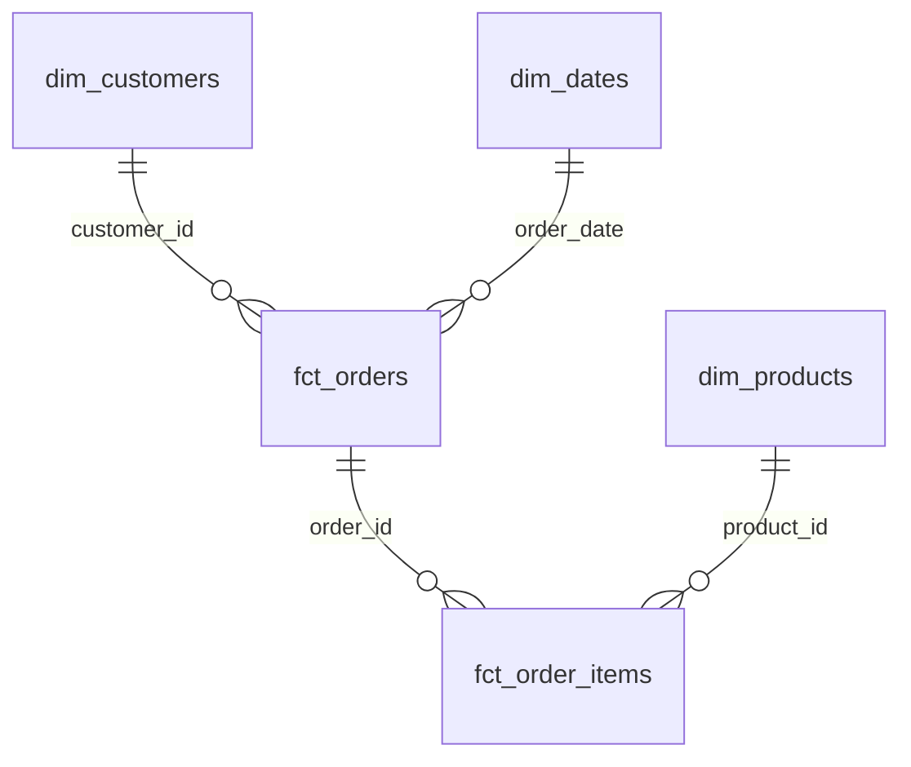
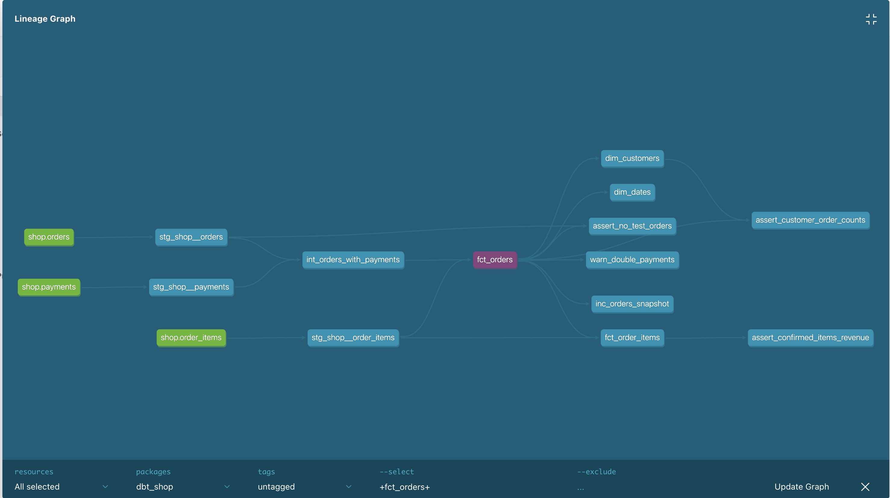

# Домашнее задание 

### Архитектура

PostgreSQL (shop)
    → loader
    → Greenplum (raw)
    → dbt staging
    → dbt intermediate
    → dbt marts

### Модели

| Модель | Зернистость | Контрольное количество |
|---|---|---:|
| fct_orders | Один заказ | 135 |
| fct_order_items | Одна позиция заказа | 425 |
| dim_customers | Один клиент | 40 |
| dim_products | Один товар | 13 |
| dim_dates | Один календарный день | 133 |

Схема витрин: analytics_marts.

### Бизнес-правила

- Тестовые заказы исключены из факта заказов.
- Подтверждённый заказ имеет статус paid и успешную оплату.
- В fct_orders вычисляется число различных товаров items_count.
- dim_customers включает клиентов без покупок.
- Категории товаров разворачиваются с помощью WITH RECURSIVE.
- dim_dates охватывает период с 2026-03-01 по 2026-07-11.

### Тесты

Используются generic-тесты:
unique, not_null, relationships, accepted_values,
а также пользовательский non_negative.

Singular-тесты проверяют:
- отсутствие тестовых заказов;
- сумму подтверждённых товарных позиций;
- количество подтверждённых заказов клиентов;
- двойные списания по заказам.

Тест двойного списания настроен как WARN.
Известный проблемный заказ: 113.

### Дополнительное задание

Создана модель inc_orders_snapshot
с materialized='incremental'.

Стратегия: append.

При повторном запуске без новых заказов
количество строк не увеличивается.

Ограничение: фильтр по максимальному order_id
не обрабатывает изменения старых заказов
и поздно поступившие заказы с меньшим order_id.

### Запуск

docker compose up -d

docker compose run --rm dbt debug

docker compose run --rm dbt build

docker compose run --rm dbt docs generate

### Контрольные результаты

- fct_orders: 135 строк
- fct_order_items: 425 строк
- Подтверждённые позиции: 91620 рублей
- dim_customers: 40 клиентов, 29 покупателей
- dim_products: 13 товаров
- dim_dates: 133 дня
- dbt build: ERROR=0

### ER-диаграмма

[Посмотреть схему витрин](docs/erd.md)

## Модель данных

### ER-диаграмма схемы «звезда»

Подробная диаграмма: [docs/erd.md](docs/erd.md).

### Зернистость и бизнес-вопросы

| Витрина | Зернистость | Бизнес-вопрос |
|---|---|---|
| fct_orders | Один заказ | Сколько заказов оформлено, оплачено и возвращено? |
| fct_order_items | Одна товарная позиция | Какие товары и в каком количестве продаются? |
| dim_customers | Один клиент | Кто покупает, сколько заказов и выручки приносит клиент? |
| dim_products | Один товар | Какие товары продаются по категориям и брендам? |
| dim_dates | Один календарный день | Как меняются заказы и продажи по датам, месяцам и дням недели? |

### Хранение в Greenplum

| Витрина | Схема | Материализация | Распределение | Хранение |
|---|---|---|---|---|
| fct_orders | analytics_marts | table | order_id | AO Column, zlib |
| fct_order_items | analytics_marts | table | order_id | AO Column, zlib |
| dim_customers | analytics_marts | table | REPLICATED | стандартное |
| dim_products | analytics_marts | table | REPLICATED | стандартное |
| dim_dates | analytics_marts | table | REPLICATED | стандартное |

Параметры хранения необходимо сверить
с системными каталогами Greenplum.

### Lineage

Граф зависимостей создан с помощью dbt Docs.

